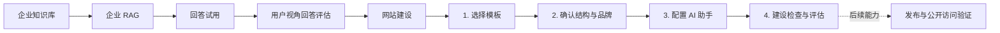

# AI 官网产品流程与设计说明

> 文档状态：当前原型设计记录  
> 最后更新：2026-10-10  
> 适用范围：企业 RAG、网站建设与建设评估  
> 重要说明：本文同时记录当前原型已经实现的能力与未来正式产品能力；两者不可混用。

## 1. 背景与目标

本轮根据组会意见，将“AI 专用官网”收敛为两个相互关联的部分：

1. **企业 RAG**：建立可复用的企业知识与回答底座，同时呈现可放入网站的 AI 助手组件。
2. **网站建设**：基于企业知识和 RAG 能力，完成帮助中心式网站的模板、结构、品牌、AI 助手与建设评估。

产品面向希望快速建立企业帮助中心、产品文档站或服务门户的运营人员。用户不需要先理解模型、召回阈值或 RAG Pipeline，而是按照“准备知识—建设网站—检查结果”的自然顺序完成任务。

当前阶段优先解决“先建设、再评估”。域名、SEO、访问权限和正式上线暂不进入建站主流程。

## 2. 核心设计原则

### 2.1 按用户任务组织，而不是按技术模块组织

企业问答和网站 AI 组件都依赖同一套知识范围、检索规则与回答逻辑，因此合并在“企业 RAG”中。用户只需理解：先准备一套可信的企业回答能力，再把它用于网站。

### 2.2 先建立事实底座，再建设对外网站

顶部导航将“企业 RAG”放在“网站建设”之前。网站正文和 AI 助手都依赖企业知识、引用来源及公开范围；先确定底座，可以避免在不同页面重复配置，也能降低“外观已经完成、事实依据仍缺失”的风险。

这是推荐工作顺序，不是强制权限限制。用户仍可随时在两个页面之间切换。

### 2.3 配置完成、质量通过和正式发布彼此独立

- **配置完成**：用户确认了模板、结构、品牌和 AI 助手。
- **质量通过**：网站和 RAG 已按正式用例完成评估并留有证据。
- **正式发布**：网站已部署，而且公开地址经过访问验证。

三种状态不可相互替代。“确认当前建设草稿”不表示评估通过，也不表示网站已经发布。

### 2.4 所见即所得与渐进披露

结构、品牌和 AI 助手调整时，同屏展示网站预览；模型、召回阈值、提示词、域名和 SEO 等低频设置放入高级设置或后续流程，降低首次使用成本。

### 2.5 不伪装尚未接入的能力

当前原型不会把本地示例描述成真实业务结果。外部模板链接、官网 URL、RAG 回答、引用和评估状态都明确标注原型边界。

### 2.6 统一五档字体层级

企业 RAG、网站建设及页面内预览统一使用最多五档字号。页面级、步骤级和卡片级标题分别占一档，避免二级标题与正文混在一起；正文与辅助信息再分两档，兼顾层级清晰和页面整洁：

| 层级 | 字号 | 常用字重 | 用途 |
| --- | ---: | ---: | --- |
| 页面级 | 28 px | 700 | 页面主标题、评估总分和预览 Hero 标题 |
| 步骤级 | 22 px | 700 | 当前建设步骤主标题和重要指标值 |
| 二级标题 | 16 px | 600／700 | 模板、分组、卡片、预览区和加权评分标题 |
| 正文与控件 | 14 px | 500／600 | 正文、输入框、按钮、列表项和字段标签 |
| 辅助信息 | 12 px | 500／600／700 | 状态、标签、来源、说明和预览细节 |

原先 8–11 px 的微小文字统一提高到 12 px。二级标题固定使用 16 px，并通过 600／700 字重与正文拉开层级；同一页面不再引入第六种字号。窄屏通过换行和单列布局适配，不额外缩小字体。

## 3. 整体信息架构



顶部信息架构按依赖关系排列：

1. 企业 RAG
2. 网站建设

企业 RAG 页面包含企业知识范围、回答示例试用、用户视角的回答质量评估，以及进入网站建设 AI 助手步骤的入口。

网站建设页面包含四个步骤，并允许用户返回已完成的步骤修改。

## 4. 企业 RAG 的设计

### 4.1 为什么合并企业问答与 AI 组件

企业问答是对底层 RAG 能力的验证方式，网站 AI 助手是同一能力的对外载体。拆成两个独立子板块会造成知识范围和回答逻辑重复配置，也容易让用户误以为存在两套回答系统。

因此当前页面同时展示：

- 左侧：RAG 知识底座和回答示例试用。
- 右侧：针对当前示例问答的用户需求判断、问题定位和优化方案。
- 底部：进入网站建设 AI 助手步骤的明确入口。

右侧评估与左侧试用复用同一份当前问题、回答和证据。默认区只保留“评分与门禁结论—六维得分—用户任务—首选优化动作”，与左侧知识及试用区自适应齐底；规则、完整证据、人工评审、优化改写与历史记录放入抽屉，避免长说明把右栏撑高。

现已按[《企业 RAG 问答评估方案 v1.0》](./企业RAG-问答评估方案-v1.0.md)接入独立规则层。默认问题的预设六维等级为 `3、4、2、4、3、4`，实际计算 `15 + 25 + 7.5 + 15 + 11.25 + 10 = 83.75`，展示为 `84/100`，不再硬编码旧版 `82`。六维权重固定为需求 20、正确性 25、完整性 15、引用 15、清晰行动 15、边界安全 10；结论使用未取整原始分。七项门禁独立判定，任一失败均不可用，待核验不能被当成通过。

页面提供六条合成样例及预设评审，支持正常回答、流程操作、正确拒答、歧义澄清、越权和无依据承诺的不同结果。输入非样例问题时，不复用默认回答：当前回答、维度与门禁进入待补充状态，用户可录入实际回答与任务后做人工评审。此处没有自动模型裁判；样例分数只证明计算与交互流程，不代表真实企业问答表现。

### 4.2 证据、人工评审和本地记录

- 证据抽屉展示“回答陈述—支持状态—来源原文—章节／版本／公开范围”，以及每维理由、证据定位和七项门禁说明。合成资料使用锁定快照 `KB-SYN-v1`；未知期限的负向审计只适用于该快照。
- 人工评审表要求逐维填写 `0–4` 等级、判断理由与证据定位，逐项填写门禁状态与核验依据，并记录评审人。缺项可保存，但缺少有效等级、理由或证据定位的维度不计为已判定；当前表单不允许在看到低分后临时删除适用维度。
- 六维未判完时显示 `—/100`、已判定权重覆盖率和数学上的可能分数范围；维度完整但门禁待核验时仍不能给出可用结论。覆盖率表示评审完整性，不是证据真实性、评审一致性或统计可信度。人工证据定位目前为文本记录，尚未自动验证原文是否支持判断。
- 保存时记录当前问题、完整回答、用户任务、评审人、时间、知识版本、规则版本、六维判断与门禁。记录保存在当前浏览器，最多 30 条；超过上限会移出最旧记录，不是正式长期审计库。人工自定义回答标记为待绑定正式知识版本。
- 编辑回答、改变用户任务或采用建议改写后，当前评审清空并要求重评；已有本地记录保留原快照，历史区会区分是否仍与当前文本相同。尚未绑定真实检索、模型和知识变更事件，不能声称已自动识别全部版本过期情况。
- “测试集演示”分别统计两条代表样例和四条风险挑战样例，点击用例可返回单题详情。合成代表集均分和挑战可用数分开呈现，不混成正式系统分，也不产生 95% 置信区间或上线结论。

完整双人盲评、第三人裁决、自动与人工校准、正式批量运行和版本配对比较仍是后续能力。当前单人评审只用于本地验证，不以“高可信”包装已填写完整的表单。

### 4.3 与网站建设的衔接

- 从独立的企业 RAG 页面点击“开始网站建设”，进入网站建设第 1 步。
- 点击“进入网站建设的 AI 助手”，直接进入第 3 步。
- 从网站建设打开企业 RAG 时，记录来源步骤，便于返回原来的建设位置。
- 网站助手的名称、欢迎语和主题色集中放在网站建设第 3 步配置，企业 RAG 页面专注回答试用与质量评估。

## 5. 网站建设四步流程

### 第 1 步：选择模板

目标是先确定网站整体版式与视觉方向。

当前提供“知识帮助中心”“简洁文档站”和“企业服务门户”三种本地示例，用户也可保存一个外部模板参考链接。

设计边界：

- 模板只决定版式和默认配色，网站事实内容仍来自企业知识库。
- 当前原型只保存外部链接，不读取、复制或抓取远程页面。
- 正式版本应先解析并生成预览，再由用户确认是否应用。

### 第 2 步：确认网站结构与品牌

系统先提供栏目骨架，用户确认以下必要信息：

- 网站名称
- Logo 或品牌标识
- 站点语言
- 网站主题色
- 对外展示的栏目

企业官网 URL 是可选输入，用于生成品牌建议。正式版本可基于官网读取品牌信息；当前原型仅从 URL 生成可编辑的本地示例。

结构和品牌合并在一个步骤中，是因为栏目、名称、语言和主题色共同决定网站骨架与首屏预览。继续拆成多个页面会增加往返操作，却不会形成新的用户决策。

当前默认栏目包括“快速开始”“产品与服务”“使用指南”“常见问题”和“联系我们”。关闭栏目只影响网站展示，不修改原知识库。

### 第 3 步：配置 AI 助手

该步骤配置网站右下角的帮助窗口：

- 助手名称
- 欢迎语
- 主题色
- 是否展示回答来源
- 桌面端和移动端效果

右侧预览保持助手打开，用户可以直接观察交互效果。网站助手复用企业 RAG，不需要再次选择知识。

“隐藏回答来源”只改变访客看到的展示形式，不会扩大企业资料的公开权限。

“确认结构”和“AI 助手”共用左右工作区：配置卡与预览卡在桌面端自适应齐底，预览画布随内容量延展，不使用固定页面高度制造空白；窄屏时恢复自然单列。官网品牌建议输入在桌面端采用输入框与操作按钮同行，AI 助手的欢迎语编辑区可弹性增长，使两页在保持简洁的同时维持一致的视觉重心。

### 第 4 步：建设检查与评估

评估承担两个任务：

1. 检查建站选择是否已经由用户确认。
2. 检查网站内容、企业事实、RAG 回答和发布边界是否有正式证据。

页面保留满分 100 的总分，便于快速理解整体成熟度；关键门禁仍单独判断，不能被其他项目的高分抵消。当前草稿可以被确认，但只有正式评估证据齐全后，才能进入发布确认。

## 6. 评估模型

### 6.1 配置门槛

以下四项只判断用户是否完成建站选择，不计入质量分：

- C01 模板版式
- C02 网站结构
- C03 品牌与语言
- C04 AI 助手配置

配置门槛未完成时，不允许确认当前建设草稿。
建设评估页仅在摘要与确认操作中反映配置完成度，不再单独展示配置门槛明细板块。

### 6.2 100 分权重

| 评估领域 | 权重 | 当前检查内容 |
| --- | ---: | --- |
| 网站内容与体验 | 30 | 版本、目标问题覆盖与信息结构 15；导航与联系入口 7；窄屏与键盘可用性 8 |
| 企业事实与公开边界 | 30 | 企业事实与证据 15；公开范围与来源展示 15 |
| RAG 回答质量 | 25 | 回答引用、正确性与未知问题处理 25 |
| 流程与发布边界 | 15 | 建站流程、反馈与失败恢复 10；草稿、发布与正式生效 5 |
| **合计** | **100** | — |

### 6.3 计算公式和状态系数

```text
总分 = 100 × Σ（适用项权重 × 状态系数）÷ Σ适用项权重
```

| 状态 | 系数 | 是否属于正式判定 |
| --- | ---: | --- |
| 通过 | 1 | 是 |
| 有证据的部分满足 | 0.5 | 是 |
| 不通过 | 0 | 是 |
| 待核实 | 0 | 否 |
| 未执行 | 0 | 否 |
| 受阻 | 0 | 否 |
| 经批准的无需适用 | 不进入分母 | 否 |

最终得分四舍五入为整数。尚未完成正式验收时显示“暂定分”；0 分表示尚未取得正式评估分，不表示网站质量已经被判定为零。

辅助指标口径：

- **判定覆盖率**＝已正式判定项目的权重 ÷ 全部适用项目权重。通过、部分满足和不通过都属于正式判定。
- **已判定通过率**＝通过项数量 ÷（通过项数量＋不通过项数量）。没有通过或不通过记录时显示“无法计算”。
- **关键门禁待处理**＝所有适用且尚未通过的关键项目数量。

界面只展示指标名称、数值、简洁算式和一行四类权重概览；完整公式、系数与门禁规则集中记录在本文，避免用户在操作页面反复阅读规则说明。

### 6.4 分数区间与关键门禁

- 85–100：可进入发布确认
- 70–84：待补证或修订
- 0–69：暂不建议发布

以下关键门禁未闭环时，无论总分多高都暂不建议发布：

- 企业事实和能力声明缺少可追溯证据
- 公开范围或授权确认人未记录
- RAG 引用、正确性或未知问题处理未验证
- 草稿、正式生效和公开访问状态未验证

总分服务于概览，关键风险不能被平均分掩盖。“可进入发布确认”也不表示已经发布。

### 6.5 与参考评估规范的关系

参考资料中的 `02-Evaluation机制.md` 建议逐项汇报，不计算加权总分。本轮根据当前产品决策增加了满分 100 的“建设成熟度”汇总分，用于快速展示整体进度和支持阶段比较。

为了避免总分造成误导，当前方案仍保留参考规范中的逐项状态、判定覆盖率、关键问题数量、证据要求和发布门禁。总分是补充视图，不替代逐项结论。

### 6.6 内容变化后的失效规则

模板、结构、品牌或 AI 助手配置发生变化后，对应步骤的确认状态自动失效；已经确认的建设草稿也需要重新确认。

正式版本还应使受影响的质量评估结果过期，并绑定以下信息：

- 项目
- 被测环境和目标 URL
- 网站草稿版本
- 知识库版本
- 页面与目标问题范围
- 公开范围和确认人
- 评估人和执行时间
- 评估证据

## 7. 竞品参考：HelpLook

本节只依据本轮提供的四张 HelpLook 创建项目截图记录可观察特征，不代表对其完整产品能力的判断。

| 截图中可见的设计 | 带来的启发 | 本产品的处理 |
| --- | --- | --- |
| 左侧纵向步骤：选择场景、填写官网、设置前台、设置权限 | 用向导降低首次创建成本，并让用户知道当前位置 | 使用四步建站流程与固定的“上一步／继续”操作 |
| 帮助中心、电商／产品说明书、内部知识库、企业博客等场景卡片 | 先让用户选择结果形态，比先配置技术参数更易理解 | 将第一步设计为选择网站模板版式 |
| 官网 URL 为可选项，并用于配置主页、品牌和主题 | 可利用已有官网减少品牌资料填写 | 在结构与品牌步骤提供可选官网 URL 和可编辑建议 |
| 左侧填写项目名称、语言、Logo 和主题色，右侧实时预览 | 编辑和结果并列能降低理解成本 | 结构和 AI 助手步骤都采用配置区加即时预览 |
| 公开、密码、授权、混合访问四种权限 | 访问边界必须在发布前明确 | 当前迭代暂不展开上线流程，但在评估中保留公开范围门禁 |
| 页面提示设置以后仍可修改 | 向导不应是一次性、不可逆提交 | 自动保存本地草稿，并支持点击步骤返回修改 |

本产品没有照搬 HelpLook 的完整创建步骤。访问权限和发布设置被延后，是因为当前任务重点是完成网站建设与评估，避免让低频上线配置挤占首次建站主流程。

## 8. 主要设计取舍及原因

### 企业 RAG 排在网站建设之前

网站内容和 AI 助手依赖知识与公开边界，先准备底座更符合依赖关系，也能避免重复配置。

### 将结构与品牌合并

栏目、名称、语言和主题色共同构成网站骨架，放在同一页面更适合即时预览，并减少向导步骤。

### AI 助手单独成为一步

助手既有独立的外观配置，也需要现场试问和查看来源，信息量足以构成一个清晰任务。

### 模板与知识内容分离

外部模板只影响布局，不直接改写企业事实，防止模板中的示例文字混入企业知识。

### 保留总分，同时设置独立门禁

数字分数便于汇报、比较和观察改进；企业事实、公开授权、RAG 正确性与正式发布不能通过平均分被掩盖。

### 上线设置延后

当前阶段先证明“用户能顺利建站并检查质量”。域名、SEO、访问权限与部署将在后续形成独立的发布确认流程。

## 9. 页面与路由映射

| 页面／步骤 | 当前本地预览路由 | 主要作用 |
| --- | --- | --- |
| 企业 RAG | `/?view=enterprise-rag` | 知识快照、回答试用、六维评审、证据与测试集演示 |
| 选择模板 | `/?view=website` | 选择本地版式或保存外部模板参考链接 |
| 确认结构与品牌 | `/?view=website&step=structure` | 栏目、名称、语言、标识和主题色 |
| 配置 AI 助手 | `/?view=website&step=assistant` | 助手样式、来源开关与现场预览 |
| 建设检查与评估 | `/?view=website&step=evaluation` | 配置完成摘要、加权分数、质量项目和风险 |

企业 RAG 还支持 `returnStep` 参数，用于从建站流程返回原步骤。该参数属于当前原型的导航实现，不代表正式产品必须沿用同一路由结构。

## 10. 当前原型边界

当前已经实现：

- 企业 RAG 和网站建设的导航顺序与双向跳转
- 企业知识、回答试用和用户视角回答评估的合并展示
- 企业 RAG 独立六维评分规则、七项关键门禁、覆盖率和可能得分范围
- 合成陈述与来源原文、人工评审表、最近 30 条本地快照记录
- 代表集与挑战集分开展示的六条合成测试用例
- 规则、证据、改进回答、人工评审和记录的抽屉式布局
- 四步网站建设流程
- 桌面端与移动端预览
- 本地草稿自动保存与恢复
- 修改配置后撤销相关步骤确认
- 100 分加权评分、判定覆盖率和关键门禁展示

当前尚未实现：

- 真实企业官网抓取
- 外部模板解析和导入
- 真实 RAG 检索、模型调用和引用验证
- 真实单次问答与自动裁判服务、陈述级语义核验、真实知识版本绑定
- 正式批量评估、重复运行与置信区间、双人盲评和第三人裁决
- 完整网站正文生成与编辑
- 正式评估任务、证据上传、身份认证及服务端长期审计记录
- 域名、SEO、访问权限和发布
- 部署完成后的公开访问验证

原型中的知识集合、知识片段、回答和来源均为合成示例数据，不代表真实业务结果。

## 11. 后续计划

### P0：完成真实质量闭环

- 绑定知识库、网站草稿和评估版本
- 记录企业事实来源、公开范围和确认人
- 接入真实 RAG 检索、引用和未知问题测试
- 建立目标问题清单和逐项评估证据
- 内容改变后自动标记旧评估过期

### P1：增强建站能力

- 外部模板安全解析与预览确认
- 完整正文生成和页面编辑
- 导航、联系入口、窄屏和键盘可用性检查
- 访问权限与发布前确认

### P2：上线与持续复测

- 域名、SEO、部署和公开访问验证
- 网站 AI 助手嵌入代码
- 发布后使用同一套问题和知识版本复测
- 展示相对基线的变化和版本历史

## 12. 待确认问题

- 六维评分权重与建议发布门槛是否在首轮真实样本校准后冻结
- 首次正式评估的代表集、挑战集规模与各业务场景权重
- 自动裁判与人工评审采用哪些模型、角色和一致性门槛
- 目标问题清单由系统生成，还是由用户确认后生效
- 外部模板允许导入哪些格式，以及如何处理版权和安全问题
- 公开范围由什么角色确认
- 哪些内容变化需要整站重评，哪些只重评受影响项

## 13. 参考资料

- 本轮组会关于“网站建设流程＋企业 RAG”的讨论结论
- 用户提供的 HelpLook 创建项目流程截图
- `D:/cuhksz/26-27term1/enterprise_web/AI官网-Evaluation与UI设计-v1.0(1)/2026-09-30_10-06`
  - `01-现状来源与流程.md`
  - `02-Evaluation机制.md`
  - `04-UI交互与状态说明.md`
  - `05-追溯矩阵.md`

## 14. 当前实现位置

- `SimplifiedWebsiteBuilderPreview.tsx`：四步建站、草稿状态、评估与预览
- `EnterpriseRagPreview.tsx`：企业 RAG、回答试用、用户视角回答评估和建站入口
- `rag-evaluation.ts`：独立六维、七门禁、未完成判断和场景汇总的纯计算规则
- `rag-evaluation-cases.ts`：六条合成样例、预设评审、陈述与证据和优化方案
- `rag-evaluation-ui.css`：紧凑评估工作区、抽屉和窄屏适配
- `simplified-product-preview.css`：两块产品流程的界面样式
- `SimplifiedProductFlowPreview.test.tsx`：流程、跳转、草稿与评估行为测试
- `standalone/App.tsx`：本地预览路由和两个页面之间的衔接

## 15. 界面微文案取舍记录

### 15.1 判定原则

界面只保留帮助用户完成当前任务的信息：当前任务、动态状态、输入要求、操作结果、直接影响、风险和修复入口。以下内容默认放在本文而不占用操作页面：

- 产品架构和功能依赖的解释
- 本地原型的具体实现方式
- 尚未开放的能力和后续规划
- 已在标题、导航或预览中表达过的重复说明
- 评估方法学、内部编号和逐项权重明细

全局“本地预览”提示统一说明示例数据边界，局部只在容易误解的结果旁保留“本地示例”等状态标记。一个事实原则上只在最接近用户决策的位置出现一次。

### 15.2 本轮从界面移出的内容

| 页面／位置 | 移出的内容 | 原因与文档归属 |
| --- | --- | --- |
| 共通页头和步骤条 | 重复的产品层级短标题、四个步骤的说明句、整条自动保存说明 | 顶部导航和步骤名已经完成定位；保存状态仍保留在页头。流程见第 5 节，草稿机制见第 10 节。 |
| 选择模板 | “已选 1 个”、外链不会抓取远程页面的长说明、重复的分类卡说明 | 选中状态可由卡片直接感知；模板导入边界见第 5.1 节和第 10 节。 |
| 确认结构与品牌 | 官网 URL 的原型实现说明、未来编辑器能力、重复的预览状态 | 页面只保留“仅控制栏目显示，不修改知识库”这一直接后果；正式能力与原型差异见第 5.2 节和第 10 节。 |
| 配置 AI 助手 | “直接在右侧试用”提示卡和预览区重复说明 | 输入框与已打开的助手窗口已表达可试用；企业 RAG 复用关系见第 4 节和第 5.3 节。 |
| 建设检查与评估 | 分组方法说明、内部检查编号、逐项权重标签、状态系数长说明、后续上线设置 | 页面保留总分、四类权重、分组得分、逐项状态、关键门禁和修复入口；完整指标、公式及门禁见第 6 节，上线安排见第 8 节和第 11 节。 |
| 企业 RAG | 流程节点的解释句、原型说明副标题、“高级设置（后续开放）”、对话时间、重复同步说明 | 页面保留知识数量、来源、试问、回答评估、优化方案和建站入口；知识复用与评估设计见第 4 节，真实 RAG 与正式评估计划见第 10 节和第 11 节。 |

配置门槛规则与 `C01–C04` 编号保留在第 6.1 节，用于说明草稿确认逻辑；`E01–E18` 及逐项分值保留在第 6.2 节，用于实现、测试和追溯。这些内部编号不面向普通建站用户展示。

### 15.3 必须留在界面的微文案

- 表单名称、输入示例、校验错误和操作成功／失败结果
- 草稿是否保存、知识范围数量、来源是否展示等动态状态
- 开关会改变什么，例如“仅控制栏目显示，不修改知识库”
- 加权总分、四类权重、暂定状态、当前建议和建议原因
- 关键门禁、风险详情以及“去确认／去检查”等修复入口
- 无障碍名称、输入框占位文字及屏幕阅读器提示

### 15.4 后续维护规则

新增微文案前先确认它是否会改变用户当下的选择或操作；如果只是解释为什么这样设计、技术上如何实现或未来会做什么，应优先更新本文。若正式功能接入后某项说明会直接影响用户决策，再把最短、最具体的后果提示放回对应控件附近。

