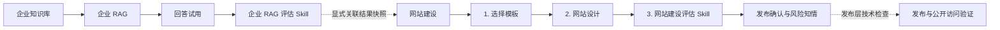

# AI 官网产品流程与设计说明

> 文档状态：当前原型设计记录  
> 最后更新：2026-10-29
> 适用范围：企业 RAG、网站建设与建设评估  
> 重要说明：本文同时记录当前原型已经实现的能力与未来正式产品能力；两者不可混用。

## 1. 背景与目标

本轮根据组会意见，将“AI 专用官网”收敛为两个相互关联的部分：

1. **企业 RAG**：建立可复用的企业知识与回答底座，同时呈现可放入网站的 AI 助手组件。
2. **网站建设**：基于企业知识和 RAG 能力，完成模板选择、统一网站设计与建设评估。

产品面向希望快速建立企业帮助中心、产品文档站或服务门户的运营人员。用户不需要先理解模型、召回阈值或 RAG Pipeline，而是按照“准备知识—建设网站—检查结果”的自然顺序完成任务。

当前阶段优先解决“先建设、再评估”。域名、SEO、访问权限和正式上线暂不进入建站主流程。

## 2. 核心设计原则

### 2.1 按用户任务组织，而不是按技术模块组织

企业问答和网站 AI 组件都依赖同一套知识范围、检索规则与回答逻辑，因此合并在“企业 RAG”中。用户只需理解：先准备一套可信的企业回答能力，再把它用于网站。

### 2.2 先建立事实底座，再建设对外网站

顶部导航将“企业 RAG”放在“网站建设”之前。网站正文和 AI 助手都依赖企业知识、引用来源及公开范围；先确定底座，可以避免在不同页面重复配置，也能降低“外观已经完成、事实依据仍缺失”的风险。

这是推荐工作顺序，不是强制权限限制。用户仍可随时在两个页面之间切换。

### 2.3 配置完成、质量通过和正式发布彼此独立

- **配置完成**：用户确认了模板以及一份同时覆盖网站结构、主题与助手设置的网站设计草稿。
- **质量通过**：网站和 RAG 已按正式用例完成评估并留有证据。
- **正式发布**：网站已部署，而且公开地址经过访问验证。

三种状态不可相互替代。“确认当前建设草稿”不表示评估通过，也不表示网站已经发布。质量分、覆盖率和关键风险只形成建议，不剥夺用户进入发布确认的选择；用户可以在看到并确认风险后继续。只有发布层确认的技术不可发布条件（例如构建失败、部署目标缺失或域名配置无效）可以阻止真正的发布操作。

### 2.4 所见即所得与渐进披露

网站基础、页面栏目、网站与助手主题、助手文案调整时，同屏展示一份网站与助手统一预览；模型、召回阈值、提示词、域名和 SEO 等低频设置放入高级设置或后续流程，降低首次使用成本。栏目区域默认只展示“共 N 个栏目，N 个启用”的摘要，展开后才显示完整列表。

### 2.5 不伪装尚未接入的能力

当前原型不会把本地示例描述成真实业务结果。外部模板链接、RAG 回答、引用和评估状态都明确标注原型边界。真实 SiteOps 模式下的网站推荐和预览内容投影绑定当前发布知识快照；知识不足时保留空值或待确认状态，不用虚构内容补齐。

### 2.6 统一五档字体层级

企业 RAG、网站建设及页面内预览统一使用最多五档字号。页面级、步骤级和卡片级标题分别占一档，避免二级标题与正文混在一起；正文与辅助信息再分两档，兼顾层级清晰和页面整洁：

| 层级 | 字号 | 常用字重 | 用途 |
| --- | ---: | ---: | --- |
| 页面级 | 28 px | 700 | 页面主标题、评估总分和预览 Hero 标题 |
| 步骤级 | 22 px | 700 | 当前建设步骤主标题和重要指标值 |
| 二级标题 | 16 px | 600／700 | 模板、分组、卡片、预览区和加权评分标题 |
| 正文与控件 | 14 px | 500／600 | 正文、输入框、按钮、列表项和字段标签 |
| 辅助信息 | 12 px | 500／600／700 | 状态、标签、来源、说明和预览细节 |

原先 8–11 px 的微小文字统一提高到 12 px。二级标题固定使用 16 px，并通过 600／700 字重与正文拉开层级；同一页面不再引入第六种字号。窄屏通过换行和单列布局适配，不额外缩小字体。

## 3. 整体信息架构



顶部信息架构按依赖关系排列：

1. 企业 RAG
2. 网站建设

企业 RAG 页面包含企业知识范围、回答示例试用、用户视角的回答质量评估，以及进入“网站设计”的入口。

网站建设页面全局只包含“选择模板—网站设计—建设评估”三个步骤，并允许用户返回已完成的步骤修改。

## 4. 企业 RAG 的设计

### 4.1 为什么合并企业问答与 AI 组件

企业问答是对底层 RAG 能力的验证方式，网站 AI 助手是同一能力的对外载体。拆成两个独立子板块会造成知识范围和回答逻辑重复配置，也容易让用户误以为存在两套回答系统。

因此当前页面同时展示：

- 左侧：RAG 知识底座和回答示例试用。
- 右侧：针对当前示例问答的用户需求判断、问题定位和优化方案。
- 底部：进入网站建设“网站设计”步骤的明确入口。

右侧评估与左侧试用复用同一份当前问题、回答和证据。默认区只保留“评分与关键风险—六维得分—用户任务—首选优化动作”，与左侧知识及试用区自适应齐底；规则、完整证据、人工评审、优化改写与历史记录放入抽屉，避免长说明把右栏撑高。

现已按[《企业 RAG 问答评估方案 v1.0》](./企业RAG-问答评估方案-v1.0.md)接入独立的 `enterprise-rag-evaluation` Skill。默认问题的预设六维等级为 `3、4、2、4、3、4`，实际计算 `15 + 25 + 7.5 + 15 + 11.25 + 10 = 83.75`，展示为 `84/100`，不再硬编码旧版 `82`。六维权重固定为需求 20、正确性 25、完整性 15、引用 15、清晰行动 15、边界安全 10；结论使用未取整原始分。七项关键风险独立判定，任一风险触发时当前回答仍标记为“不可用”，待核验不能被当成通过；这是回答级质量语义，不是发布权限。

页面提供七条合成样例及预设评审，支持正常回答、流程操作、正确拒答、歧义澄清、越权、无依据承诺和部署前提缺失的不同结果。输入非样例问题时，不复用默认回答：当前回答、维度与关键风险进入待补充状态，用户可录入实际回答与任务后做人工评审。此处没有自动模型裁判；样例分数只证明计算与交互流程，不代表真实企业问答表现。

### 4.2 证据、人工评审和本地记录

- 证据抽屉展示“回答陈述—支持状态—来源原文—章节／版本／公开范围”，以及每维理由、证据定位和七项关键风险说明。合成资料使用锁定快照 `KB-SYN-v1`；未知期限的负向审计只适用于该快照。
- 人工评审表要求逐维填写 `0–4` 等级、判断理由与证据定位，逐项填写风险状态与核验依据，并记录评审人。缺项可保存，但缺少有效等级、理由或证据定位的维度不计为已判定；当前表单不允许在看到低分后临时删除适用维度。
- 六维未判完时显示 `—/100`、已判定权重覆盖率和数学上的可能分数范围；维度完整但关键风险待核验时仍不能给出回答级“可用”结论。覆盖率表示评审完整性，不是证据真实性、评审一致性或统计可信度。人工证据定位目前为文本记录，尚未自动验证原文是否支持判断。
- 保存时记录当前问题、完整回答、用户任务、评审人、时间、知识版本、规则版本、六维判断与关键风险。记录保存在当前浏览器，最多 30 条；超过上限会移出最旧记录，不是正式长期审计库。人工自定义回答标记为待绑定正式知识版本。
- 编辑回答、改变用户任务或采用建议改写后，当前评审清空并要求重评；已有本地记录保留原快照，历史区会区分是否仍与当前文本相同。尚未绑定真实检索、模型和知识变更事件，不能声称已自动识别全部版本过期情况。
- 七条合成样例保留在“单次问答”的示例场景选择器中，用于逐题检查评分和风险边界；页面不再提供测试集汇总界面，也不使用这些样例生成正式系统分、95% 置信区间或上线结论。

完整双人盲评、第三人裁决、自动与人工校准、正式批量运行和版本配对比较仍是后续能力。当前单人评审只用于本地验证，不以“高可信”包装已填写完整的表单。

### 4.3 与网站建设的衔接

- 从独立的企业 RAG 页面点击“开始网站建设”，进入网站建设第 1 步。
- 点击“进入网站设计”，直接进入第 2 步。
- 从网站建设打开企业 RAG 时，记录来源步骤，便于返回原来的建设位置。
- 网站名称、建站目标、主栏目、网站主题色以及助手名称、欢迎语和配色集中放在同一个“网站设计”草稿中，企业 RAG 页面专注回答试用与质量评估。
- 网站建设评估不重新计算 RAG 分数。只有用户显式选择某个 RAG 评估报告时，网站建设结果才保存该报告的不可变快照 ID；未关联时明确显示“未关联 RAG 评估”，且不影响网站建设分数或进入发布确认。

## 5. 网站建设三步流程

### 第 1 步：选择模板

目标是先确定网站整体版式与视觉方向。

当前提供“知识帮助中心”“简洁文档站”和“企业服务门户”三种本地示例，用户也可保存一个外部模板参考链接。

设计边界：

- 模板只决定版式和默认配色，网站事实内容仍来自企业知识库。
- 当前原型只保存外部链接，不读取、复制或抓取远程页面。
- 正式版本应先解析并生成预览，再由用户确认是否应用。

### 第 2 步：网站设计

该步骤把原先分散的网站结构和助手配置合并成一份统一设计草稿。左侧固定为四个区域：

1. **网站基础**：网站名称、站点简介／建站目标。真实 SiteOps 模式会根据当前发布知识快照调用只读推荐 API 生成建议，用户可继续编辑；迟到响应不会覆盖用户已经修改的字段。每个字段标注“根据企业资料推荐”或“已修改”，已修改字段可单独“恢复推荐”。“刷新推荐”只更新未手动修改的字段；知识或模板版本变化后旧推荐标记为“新建议可用”，由用户决定是否刷新。用户编辑标记随草稿持久化，重新进入页面时已保存的用户值优先于新推荐；V1 旧草稿迁移时名称与建站目标同样按用户值保护。
2. **页面与栏目**：默认显示主栏目摘要，最多推荐三个最重要的真实栏目；展开后显示完整候选列表，用户可替换主栏目。未进入前三的页面不会删除，少于三个真实页面时不补假数据。
3. **主题颜色**：分别保留网站主题色和助手配色。助手可以跟随网站主题色，也可以保留独立的自定义颜色。网站色与助手名称、欢迎语、配色一起冻结进真实构建合同：构建 QA 会校验交付 CSS 实际声明 `--frontmind-site-accent` 冻结色，生产助手 widget 从冻结启动配置读取名称、欢迎语与配色，界面选择与真实产物不再脱节。
4. **助手设置**：助手名称和欢迎语。用户需在右侧统一预览完成一次问答试用；修改名称或欢迎语后需要重新试用。

右侧只保留一份“网站与助手统一预览”和一套设备选择器。预览同时展示页面内容块、栏目、网站主题和已打开的助手窗口；真实模式的页面内容块来自当前知识快照的推荐投影，而不是另一套虚拟页面数据。网站助手复用企业 RAG，不需要再次选择知识；回答来源按产品策略始终可核对，不再提供“展示回答来源”开关。

以下项目不属于现行网站设计表单，也不写入新草稿：

- 站点语言选择：语言由服务端根据知识与项目上下文确定。
- 企业官网 URL、官网品牌建议和“更多品牌设置”。
- Logo／品牌标识：预览所需的简写标识只由网站名称派生，不作为用户配置保存。
- 重复的知识卡片、第二套预览和第二套设备选择器。

四区字段通过同一个 `design` 草稿对象读取和更新。任一设计字段变化都会使“网站设计”完成状态及已确认草稿失效；不存在结构草稿和助手草稿各自保存、各自完成的并行状态。

### 第 3 步：建设检查与评估

页面先根据网站草稿与检查证据形成七项判断记录，再交给独立的 `website-build-evaluation` Skill 计算网站内容、企业事实和流程边界的质量结果。Skill 不直接理解原始网站草稿，也不承担发布授权。

页面保留满分 100 的总分，便于快速理解网站成熟度；关键风险仍单独展示，不能被其他项目的高分掩盖。评估只提供改进建议：无论分数、覆盖率、关键风险或是否关联 RAG 快照如何，用户都可以进入发布确认，并在知情确认后继续。

### 5.4 草稿与旧入口迁移

现行本地草稿为 `WebsiteDraftV2`。模板选择仍保存在草稿顶层；全部网站设计字段只保存在 `design` 下，其中助手字段位于 `design.assistant`。`completedStepIds` 只允许 `template`、`design` 和 `evaluation`，网站设计完成状态必须同时满足：至少一个真实栏目、网站名称与目标非空、助手名称与欢迎语非空，并完成当前统一预览的助手试用。

真实 SiteOps 模式使用结构化 `SiteDesignPreferences` 持久化同一组有效设计字段，并额外记录知识快照坐标、设计版本和草稿哈希。预览、首次构建、改版和评估读取同一份配置；颜色与助手配置不再拼接到 `conversionGoal` 等旧自由文本字段中。站点语言、Logo、官网 URL 和品牌建议状态不属于该契约。

载入历史 `WebsiteDraftV1` 时执行一次只读迁移：

- 保留有效的网站名称、建站目标、启用栏目、网站主题色、助手名称、欢迎语及助手配色。
- 把旧的未禁用栏目转换为 `featuredPageIds`，去重、过滤无效 ID，并最多保留三个主栏目。
- 旧草稿只有在原 `structure` 与 `assistant` 均完成时，才可迁移为候选 `design` 完成状态；由于旧试用未绑定当前知识与模板坐标，迁移后仍要求重新完成一次助手问答。
- 丢弃旧草稿中的站点语言、官网 URL、品牌建议状态、Logo／品牌标识和来源展示开关；这些字段不会进入 V2。
- 非法模板、颜色、栏目或文本会回退、过滤或截断到当前契约允许的范围；不完整设计不会保留已确认状态。

历史 URL `step=structure` 和 `step=assistant` 仅作为兼容入口解析，都会规范化为 `step=design`，随后替换为现行地址。新链接、返回链接和步骤变更不得再生成旧参数。

## 6. 评估模型

### 6.1 100 分权重

| 评估领域 | 权重 | 当前检查内容 |
| --- | ---: | --- |
| 网站内容与体验 | 40 | 版本、目标问题覆盖与信息结构 20；导航与联系入口 10；窄屏与键盘可用性 10 |
| 企业事实与公开边界 | 40 | 企业事实与证据 20；公开范围与来源展示 20 |
| 流程与发布边界 | 20 | 建站流程、反馈与失败恢复 15；草稿、发布与正式生效 5 |
| **合计** | **100** | — |

RAG 回答质量不再进入网站建设总分。网站页面只显示显式关联的 RAG `EvaluationReportSnapshot` 摘要及其 `reportId`；该快照用于提供上下文和风险提示，不折算、不复制评分，也不会随“最新结果”静默漂移。

### 6.2 两个独立 Skill 与共享结果协议

`enterprise-rag-evaluation` 与 `website-build-evaluation` 是两个可独立调用、独立测试、独立升版的评分 Skill。前者接收上游已经形成的六维判断、七项风险判断及证据定位；后者接收七项网站检查判断，以及仅作关系引用的 RAG 报告 ID。评分 Skill 本身保持纯计算边界。真实企业问答现在由独立的服务端 `evaluate-enterprise-rag` 裁判工作流读取指定问答轮次及其完整冻结知识语料，生成受证据约束的判断，再调用前者计算并持久化不可变报告；只有用户明确点击才创建模型评估任务，页面加载只读取已有记录。网站建设评估仍为独立流程，不混入 RAG 分数。两者共享 `EvaluationResult` 协议，包含：

- `skillId`、`version` 与结果 `status`；
- `score`、`coverage`、`recommendation` 与 `summary`；
- `dimensions`、`risks` 与 `relatedReportIds`。

`reportId`、`createdAt`、`subject` 与完整结果属于独立的 `EvaluationReportSnapshot`，不混入 Skill 的纯计算结果。共享协议不包含 `canPublish`、`publishAllowed`、`blockingRelease` 或 `canConfirm` 等发布授权字段。质量报告是可审计的建议快照；发布决定另行保存用户确认、所见风险与关联报告版本。

### 6.3 计算公式和状态系数

```text
总分 = Σ（固定检查项权重 × 状态系数）
```

| 状态 | 系数 | 是否属于正式判定 |
| --- | ---: | --- |
| 通过 | 1 | 是 |
| 有证据的部分满足 | 0.5 | 是 |
| 不通过 | 0 | 是 |
| 待核实 | 0 | 否 |
| 未执行 | 0 | 否 |
| 受阻 | 0 | 否 |

当前网站 Skill 使用固定的 100 分范围，不接受运行时临时把检查项标记为“不适用”；此类输入会返回评估失败，避免分项合计与归一化总分相互矛盾。最终得分四舍五入为整数。尚未执行时显示“—”，尚未完成正式验收时显示暂定结果；0 分只在已有正式判断确实得到零贡献时出现。

辅助指标口径：

- **判定覆盖率**＝已正式判定项目的权重 ÷ 固定 100 分权重。通过、部分满足和不通过都属于正式判定。
- **已判定通过率**＝通过项数量 ÷（通过项数量＋不通过项数量）。没有通过或不通过记录时显示“无法计算”。
- **关键风险待处理**＝所有适用且尚未通过的关键项目数量。

界面只展示指标名称、数值、简洁算式和一行三类权重概览；完整公式、系数与风险规则集中记录在本文，避免用户在操作页面反复阅读规则说明。

### 6.4 分数区间与关键风险

- 85–100：质量表现较好，建议进入发布确认
- 70–84：建议补证或修订，也可知情进入发布确认
- 0–69：质量风险较高，不建议直接发布，但仍可知情进入发布确认

以下关键风险未闭环时，无论总分多高都应在发布确认中明确提示：

- 企业事实和能力声明缺少可追溯证据
- 公开范围或授权确认人未记录
- 草稿、正式生效和公开访问状态未验证

总分服务于概览，关键风险不能被平均分掩盖。上述结果决定建议强弱，不决定用户能否进入发布确认。用户确认已经了解风险后仍可继续；“进入发布确认”也不表示已经发布。

### 6.5 与参考评估规范的关系

参考资料中的 `02-Evaluation机制.md` 建议逐项汇报，不计算加权总分。本轮根据当前产品决策增加了满分 100 的“建设成熟度”汇总分，用于快速展示整体进度和支持阶段比较。

为了避免总分造成误导，当前方案仍保留参考规范中的逐项状态、判定覆盖率、关键问题数量和证据要求。总分是补充视图，不替代逐项结论，也不充当发布授权。

### 6.6 内容变化后的失效规则

模板发生变化后，“选择模板”的确认状态自动失效；网站基础、页面栏目、任一主题色或助手设置发生变化后，统一的“网站设计”确认状态自动失效。任何上述变化都会使已经确认的建设草稿需要重新确认。

正式版本还应使受影响的质量评估结果过期，并绑定以下信息：

- 项目
- 被测环境和目标 URL
- 网站草稿版本
- 知识库版本
- 页面与目标问题范围
- 公开范围和确认人
- 评估人和执行时间
- 评估证据

### 6.7 与发布层的边界

发布确认层负责展示网站评估建议、显式关联的 RAG 快照和所有未解决风险，并记录用户是否知情继续。质量低、关键风险触发、评估未完成或未关联 RAG 都不能禁用发布确认入口。

真正的发布操作在独立发布层执行技术可行性检查。仅构建失败、可部署产物缺失、部署目标不可用、域名／DNS／备案配置不满足当前环境要求、并发版本冲突等会使发布在技术上无法执行的条件，才能阻止实际发布；这些条件不得混入两个质量评估 Skill 的分数或结果协议。

## 7. 竞品参考：HelpLook

本节只依据本轮提供的四张 HelpLook 创建项目截图记录可观察特征，不代表对其完整产品能力的判断。

| 截图中可见的设计 | 带来的启发 | 本产品的处理 |
| --- | --- | --- |
| 左侧纵向步骤：选择场景、填写官网、设置前台、设置权限 | 用向导降低首次创建成本，并让用户知道当前位置 | 使用三步建站流程与固定的“上一步／继续”操作 |
| 帮助中心、电商／产品说明书、内部知识库、企业博客等场景卡片 | 先让用户选择结果形态，比先配置技术参数更易理解 | 将第一步设计为选择网站模板版式 |
| 官网 URL 为可选项，并用于配置主页、品牌和主题 | 可利用已有资料减少品牌信息填写 | 本轮不采集官网 URL；网站名称与目标直接由当前发布知识生成可编辑建议 |
| 左侧填写项目名称、语言、Logo 和主题色，右侧实时预览 | 编辑和结果并列能降低理解成本 | 只保留名称、目标和主题色；语言由服务端确定，Logo 不进入契约，右侧使用一份网站与助手统一预览 |
| 公开、密码、授权、混合访问四种权限 | 访问边界应在发布确认中明确 | 当前迭代暂不展开上线流程，但在评估中保留公开范围风险提示 |
| 页面提示设置以后仍可修改 | 向导不应是一次性、不可逆提交 | 自动保存本地草稿，并支持点击步骤返回修改 |

本产品没有照搬 HelpLook 的完整创建步骤。访问权限和发布设置被延后，是因为当前任务重点是完成网站建设与评估，避免让低频上线配置挤占首次建站主流程。

## 8. 主要设计取舍及原因

### 企业 RAG 排在网站建设之前

网站内容和 AI 助手依赖知识与公开边界，先准备底座更符合依赖关系，也能避免重复配置。

### 将网站结构与助手合并为“网站设计”

页面结构、网站颜色和助手设置都在决定同一个网站体验。把它们放在同一页、写入同一草稿并使用同一预览，可以直接观察栏目、内容块、网站主题与助手主题之间的关系，也避免两套完成状态和重复设备切换。

### 保留两种主题颜色，而不是保留两个步骤

网站主题色与助手配色代表两个仍然有效的设计选择，因此都保留；助手可以选择跟随网站或自定义。现场试问也保留在统一预览中，但不再为此建立独立步骤。

### 删除低价值品牌输入

站点语言由服务端确定；官网 URL、官网品牌建议、Logo／品牌标识和“更多品牌设置”既不属于当前统一契约，也不能稳定地从知识快照证明，因此不进入主流程。删除这些输入不会删除有效的网站名称、目标、栏目、颜色和助手数据。

### 模板与知识内容分离

外部模板只影响布局，不直接改写企业事实，防止模板中的示例文字混入企业知识。

### 保留总分，同时展示独立风险

数字分数便于汇报、比较和观察改进；企业事实、公开授权和质量风险不能通过平均分被掩盖。风险展示服务于用户知情决定，不承担发布授权。

### 上线设置延后

当前阶段先证明“用户能顺利建站并检查质量”。域名、SEO、访问权限与部署将在后续形成独立的发布确认流程。

## 9. 页面与路由映射

| 页面／步骤 | 当前本地预览路由 | 主要作用 |
| --- | --- | --- |
| 企业 RAG | `/?view=enterprise-qa` | 知识快照、回答试用、六维评审、证据与评估记录 |
| 选择模板 | `/?view=website` | 选择本地版式或保存外部模板参考链接 |
| 网站设计 | `/?view=website&step=design` | 网站基础、页面与栏目、两种主题颜色、助手设置和统一预览 |
| 建设检查与评估 | `/?view=website&step=evaluation` | 配置完成摘要、加权分数、质量项目和风险 |

企业 RAG 还支持 `returnStep` 参数，用于从建站流程返回原步骤。`returnStep` 使用同一规范化规则，旧值 `structure` 或 `assistant` 会返回现行 `design` 步骤。该参数属于当前原型的导航实现，不代表正式产品必须沿用同一路由结构。

## 10. 当前原型边界

当前已经实现：

- 企业 RAG 和网站建设的导航顺序与双向跳转
- 企业知识、回答试用和用户视角回答评估的合并展示
- 企业 RAG 独立六维评分规则、七项关键风险、覆盖率和可能得分范围
- 合成陈述与来源原文、人工评审表、最近 30 条本地快照记录
- “单次问答”可切换的七条合成样例
- 规则、证据、改进回答、人工评审和记录的抽屉式布局
- 三步网站建设流程，以及唯一标题“网站设计”
- 网站设计四区：网站基础、页面与栏目、主题颜色、助手设置
- 一份网站与助手统一预览，以及一套桌面端／移动端设备选择器
- 基于当前发布知识快照的只读推荐、稳定主栏目排序与真实内容块投影
- `WebsiteDraftV2` 统一草稿的自动保存、恢复及 V1 迁移
- 修改配置后撤销相关步骤确认
- 网站建设 40／40／20 的 100 分加权评分、判定覆盖率和关键风险展示
- 企业 RAG 与网站建设两个独立可调用 Skill、共享 `EvaluationResult` 协议和显式关联快照
- 不受质量建议禁用的发布确认入口与风险知情记录

当前尚未实现：

- 真实企业官网抓取（现行网站设计流程不采集官网 URL）
- 外部模板解析和导入
- 真实 RAG 检索、模型调用和引用验证
- 真实单次问答与自动裁判服务、陈述级语义核验、真实知识版本绑定
- 正式批量评估、重复运行与置信区间、双人盲评和第三人裁决
- 完整网站正文生成与编辑
- 正式评估任务、证据上传、身份认证及服务端长期审计记录
- 域名、SEO、访问权限和发布
- 部署完成后的公开访问验证

原型中的知识集合、知识片段、回答和来源均为合成示例数据，不代表真实业务结果。

## 11. 后续计划

### P0：完成真实质量闭环

- 绑定知识库、网站草稿和评估版本
- 记录企业事实来源、公开范围和确认人
- 接入真实 RAG 检索、引用和未知问题测试
- 建立目标问题清单和逐项评估证据
- 内容改变后自动标记旧评估过期

### P1：增强建站能力

- 外部模板安全解析与预览确认
- 完整正文生成和页面编辑
- 导航、联系入口、窄屏和键盘可用性检查
- 访问权限与发布前确认

### P2：上线与持续复测

- 域名、SEO、部署和公开访问验证
- 网站 AI 助手嵌入代码
- 发布后使用同一套问题和知识版本复测
- 展示相对基线的变化和版本历史

## 12. 待确认问题

- 六维评分权重与质量建议阈值是否在首轮真实样本校准后冻结
- 首次正式评估的代表集、挑战集规模与各业务场景权重
- 自动裁判与人工评审采用哪些模型、角色和一致性门槛
- 目标问题清单由系统生成，还是由用户确认后生效
- 外部模板允许导入哪些格式，以及如何处理版权和安全问题
- 公开范围由什么角色确认
- 哪些内容变化需要整站重评，哪些只重评受影响项

## 13. 参考资料

- 本轮组会关于“网站建设流程＋企业 RAG”的讨论结论
- 用户提供的 HelpLook 创建项目流程截图
- `D:/cuhksz/26-27term1/enterprise_web/AI官网-Evaluation与UI设计-v1.0(1)/2026-09-30_10-06`
  - `01-现状来源与流程.md`
  - `02-Evaluation机制.md`
  - `04-UI交互与状态说明.md`
  - `05-追溯矩阵.md`

## 14. 当前实现位置

- `SimplifiedWebsiteBuilderPreview.tsx`：三步建站、V1/V2 草稿迁移、网站设计四区、统一预览与评估
- `EnterpriseRagPreview.tsx`：企业 RAG、回答试用、用户视角回答评估和建站入口
- `enterprise-rag-evaluation-skill.ts`：企业 RAG 评估 Skill 与共享结果协议的适配
- `website-build-evaluation-skill.ts`：网站建设 40／40／20 评估 Skill，不重复计算 RAG
- `evaluation-skill-contract.ts`：两个 Skill 共享的 `EvaluationResult` 协议
- `evaluation-report-store.ts`：评估快照、显式关联与风险知情决定的本地记录
- `rag-evaluation.ts`：独立六维、七项关键风险、未完成判断和场景汇总的纯计算规则
- `rag-evaluation-cases.ts`：七条合成样例、预设评审、陈述与证据和优化方案
- `rag-evaluation-ui.css`：紧凑评估工作区、抽屉和窄屏适配
- `simplified-product-preview.css`：两块产品流程的界面样式
- `SimplifiedProductFlowPreview.test.tsx`：流程、跳转、草稿与评估行为测试
- `standalone/App.tsx`：本地预览路由和两个页面之间的衔接

## 15. 界面微文案取舍记录

### 15.1 判定原则

界面只保留帮助用户完成当前任务的信息：当前任务、动态状态、输入要求、操作结果、直接影响、风险和修复入口。以下内容默认放在本文而不占用操作页面：

- 产品架构和功能依赖的解释
- 本地原型的具体实现方式
- 尚未开放的能力和后续规划
- 已在标题、导航或预览中表达过的重复说明
- 评估方法学、内部编号和逐项权重明细

全局“本地预览”提示统一说明示例数据边界，局部只在容易误解的结果旁保留“本地示例”等状态标记。一个事实原则上只在最接近用户决策的位置出现一次。

### 15.2 本轮从界面移出的内容

| 页面／位置 | 移出的内容 | 原因与文档归属 |
| --- | --- | --- |
| 共通页头和步骤条 | 重复的产品层级短标题、三个步骤的说明句、整条自动保存说明 | 顶部导航和步骤名已经完成定位；保存状态仍保留在页头。流程见第 5 节，草稿机制见第 5.4 和第 10 节。 |
| 选择模板 | “已选 1 个”、外链不会抓取远程页面的长说明、重复的分类卡说明 | 选中状态可由卡片直接感知；模板导入边界见第 5.1 节和第 10 节。 |
| 网站设计 | 站点语言选择、官网 URL 与品牌建议、Logo／品牌标识、更多品牌设置、来源展示开关、重复知识卡片、第二套预览与设备选择器 | 只保留会改变当前网站结果的四区字段和一份统一预览；删除项及服务端职责见第 5.2 节。 |
| 建设检查与评估 | 分组方法说明、内部检查编号、逐项权重标签、状态系数长说明、后续上线设置 | 页面保留总分、三类权重、分组得分、逐项状态、关键风险和修复入口；完整指标、公式及风险规则见第 6 节，上线安排见第 8 节和第 11 节。 |
| 企业 RAG | 流程节点的解释句、原型说明副标题、“高级设置（后续开放）”、对话时间、重复同步说明 | 页面保留知识数量、来源、试问、回答评估、优化方案和建站入口；知识复用与评估设计见第 4 节，真实 RAG 与正式评估计划见第 10 节和第 11 节。 |

旧版“配置门槛（不计分）”及 `C01–C04` 已从页面和当前评估模型删除。当前七项网站检查及逐项分值记录在第 6.1 节，用于实现、测试和追溯；内部检查标识不面向普通建站用户展示。

### 15.3 必须留在界面的微文案

- 表单名称、输入示例、校验错误和操作成功／失败结果
- 草稿是否保存、知识范围数量、来源是否可核对等动态状态
- 开关会改变什么，例如栏目启用状态“仅控制栏目显示，不修改知识库”
- 加权总分、三类权重、暂定状态、当前建议和建议原因
- 关键风险、风险详情以及“去确认／去检查”等修复入口
- 无障碍名称、输入框占位文字及屏幕阅读器提示

### 15.4 后续维护规则

新增微文案前先确认它是否会改变用户当下的选择或操作；如果只是解释为什么这样设计、技术上如何实现或未来会做什么，应优先更新本文。若正式功能接入后某项说明会直接影响用户决策，再把最短、最具体的后果提示放回对应控件附近。

